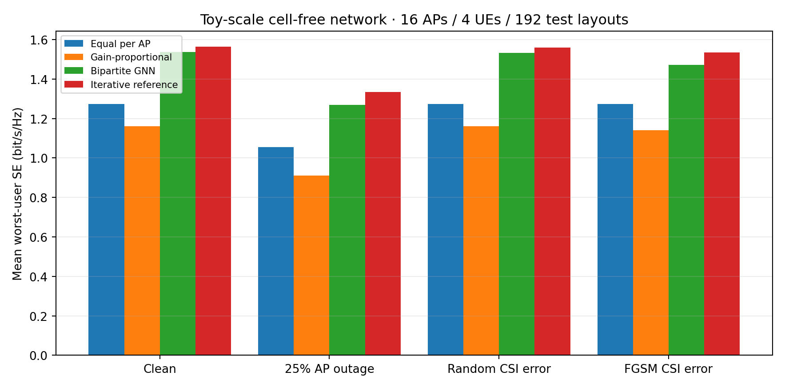
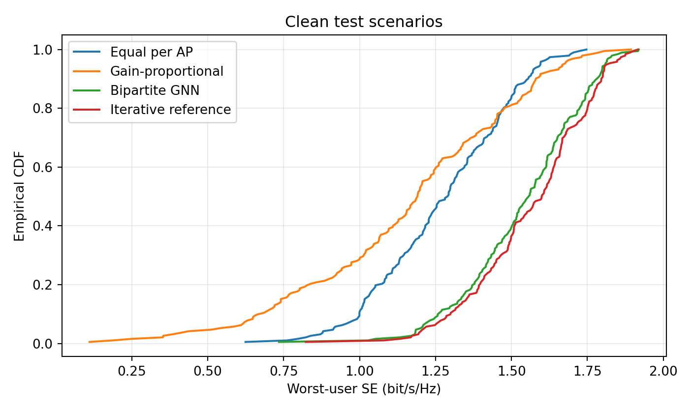
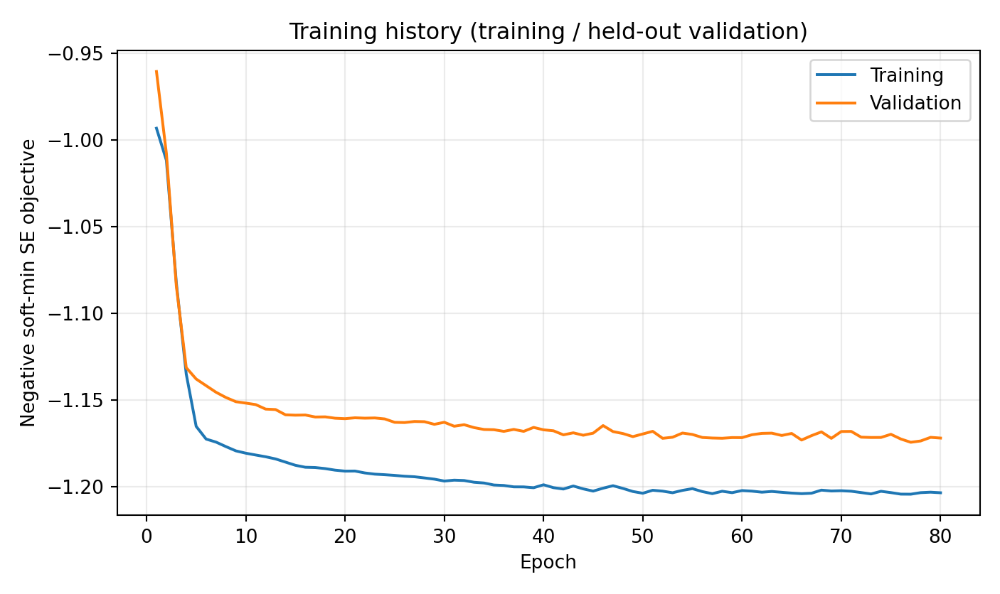

# Cell-Free Massive MIMO + Graph Neural Network Power Allocation

**A reproducible research-portfolio pilot study of user-centric wireless power control under AP outages and channel-statistics errors.**  
Author: **Amirmohammad Goodarzy** · University of Messina, Italy · November 2026

> **Status:** Independent **technical research report / portfolio project**, *not a peer-reviewed publication*. Numerical experiments were run on synthetic, normalized toy-scale networks. No real-world 5G/6G performance claims.

<p align="center"></p>

## What this repository actually contains

A working Python/PyTorch pipeline that (1) generates cell-free AP/UE layouts, (2) evaluates an analytical use-and-then-forget downlink spectral-efficiency model, (3) trains a bipartite message-passing GNN to allocate per-AP transmit power, (4) compares it to three baselines, and (5) evaluates controller-side CSI corruption and physical AP outages.

- **16 APs, 4 UEs:** 500 m × 500 m synthetic topology, 8 strongest APs serve each UE.
- **Real trained GNN:** 2 message-passing rounds, 32-dimensional latent features, unsupervised differentiable soft-min SE objective.
- **Three baselines:** equal AP power, gain-proportional allocation, per-scenario 125-step gradient-based iterative reference (not globally optimal).
- **Stress tests:** 25% AP failures; bounded random log-gain errors; GNN-targeted white-box FGSM perturbation.
- **Reproducible outputs:** learned checkpoint, 192 independent test layouts, CSV tables, JSON metrics, figures and `pytest` checks.

## Pilot results (fixed seed 42)

**Mean worst-user spectral efficiency**, bits/s/Hz; 192 held-out networks. These numbers are **simulated results for this normalized model only**.

| Condition | Equal power | Gain proportional | Bipartite GNN | Iterative reference |
|---|---:|---:|---:|---:|
| Clean | 1.274 | 1.161 | **1.537** | 1.565 |
| 25% AP outage | 1.056 | 0.911 | **1.268** | 1.335 |
| Random CSI log-error (±0.3) | 1.274 | 1.160 | **1.532** | 1.559 |
| White-box FGSM CSI log-error (±0.3) | 1.274 | 1.141 | **1.472** | 1.534 |

The GNN is **20.7% above equal allocation** on clean test layouts and **1.7% below** the non-certified iterative reference. Under targeted FGSM, the GNN score declines **4.3%** relative to its clean score. This is *not* evidence of certified robustness. Mean estimates and bootstrap intervals are in [`results/metrics.json`](results/metrics.json); per-layout records are in [`results/per_scenario.csv`](results/per_scenario.csv). An independent random train/test split and **one training seed** were used.

### Figures

| Clean-layout CDF | Training and validation loss |
|---|---|
|  |  |

## Reproduce the experiment

Requires **Python 3.10+** and a CPU with enough RAM for PyTorch (no GPU needed). Run from repository root:

```bash
python -m venv .venv
source .venv/bin/activate   # On Windows: .venv\Scripts\activate
python -m pip install -e '.[dev]'
python -m pytest -q
python -m cfmimo.experiment --epochs 80 --train 480 --test 192 --seed 42
python -m cfmimo.plots
```

Runs were performed with CPU PyTorch and `torch.use_deterministic_algorithms(True)`. Minor numeric variation across PyTorch/CPU versions is possible. A rerun overwrites files in `results/` and `figures/`. For a faster smoke test use `--epochs 5 --train 96 --test 32 --out /tmp/cfmimo-smoke` (the resulting metrics are **not** those in the paper).

To inspect the saved checkpoint:

```python
import torch
from cfmimo.gnn import PowerGNN
model = PowerGNN(hidden=32, rounds=2)
ckpt = torch.load('results/model_state.pt', map_location='cpu', weights_only=True)
model.load_state_dict(ckpt['state_dict'])
model.eval()
```

## Scientific model and evaluation

The independent Rayleigh, orthogonal-pilot, MRT/UatF approximation assumes large-scale link gains `beta[M,K]` with MMSE estimation variance:

\[ \gamma_{mk}=\frac{\tau_p p_p\beta_{mk}^{2}}{\tau_p p_p\beta_{mk}+\sigma^2}. \]

Our **analytical lower bound** (not an instantaneous fading Monte Carlo simulation) is:

\[ \mathrm{SINR}_k=\frac{(\sum_m\sqrt{p_{mk}\gamma_{mk}})^2}{\sum_m \beta_{mk}\sum_j p_{mj}+\sigma^2},\qquad \mathrm{SE}_k=\left(1-\frac{\tau_p}{\tau_c}\right)\log_2(1+\mathrm{SINR}_k). \]

`p_mk >= 0`, `sum_k p_mk <= 1`, and each disconnected AP–UE link has zero power. We explicitly test the constraints in [`tests/test_simulator.py`](tests/test_simulator.py). Pilot reuse/contamination is **not included**.

The log-beta FGSM perturbation edits *reported controller features* and minimizes the network's true soft-min performance, within per-feature `epsilon=0.3` log-error; it is **not an RF interference attack**. Under FGSM, the iterative and heuristic baselines see the **same GNN-targeted** perturbation, not separately optimized attacks.

## Files

```text
src/cfmimo/
  simulator.py        synthetic topology, association, channel quality and SE
  gnn.py              bipartite message-passing power allocator + FGSM
  optimizer.py        per-layout iterative power reference
  experiment.py       independent splits, training, evaluation, metrics
  plots.py            figures from recorded experiment data
paper/
  main.tex            complete LaTeX technical research report source
  main.pdf            compiled 4-page research report
results/
  model_state.pt      learned PyTorch state dict
  metrics.json        settings and 95% bootstrap CIs
  per_scenario.csv    full held-out observations
  training_history.csv
figures/              experiment figures
 tests/               unit tests
```

## Limitations and next steps

- **Not calibrated to 3GPP**: simplified large-scale fading; no correlated fading, shadowing, fronthaul or hardware modeling.
- **One network size and one learned seed**: no generalization, sample-complexity or cross-seed claims.
- **Iterative baseline is not SOCP or a certified upper bound**; no state-of-the-art numerical comparison.
- **No attack defense / DAE / PGD** is implemented. Future research: stronger optimization solver, attack budgets, robust training, pilot contamination, AP selection, topology transfer and uncertainty estimation.

## Paper and references

**Research report:** [`paper/main.pdf`](paper/main.pdf) (also see the [editable LaTeX](paper/main.tex)). Do **not** describe this as an IEEE publication, journal paper or accepted preprint. It is an independently prepared portfolio technical report.

Background papers (work and results belong to their respective authors):

1. Demir, Björnson and Sanguinetti, [*Foundations of User-Centric Cell-Free Massive MIMO*](https://arxiv.org/abs/2108.02541) (2021).
2. Mishra, Salaün, Yang and Chen, [*Graph Neural Network Aided Power Control in Partially Connected Cell-Free Massive MIMO*](https://doi.org/10.1109/TWC.2024.3392441) (IEEE TWC, 2024).
3. Raghunath, Peng and Jorswieck, [*Energy-Efficient Power Allocation in Cell-Free Massive MIMO via Graph Neural Networks*](https://arxiv.org/abs/2401.14281) (2024).

## CV bullet (after making the GitHub repository public)

> **Cell-Free Massive MIMO Power Allocation with a Bipartite GNN — Research Portfolio (2026)**  
> Built a reproducible PyTorch simulation of user-centric CF-mMIMO downlink power control (16 APs / 4 UEs); trained a graph neural network and evaluated fairness under 25% AP outage and bounded CSI perturbations. Achieved 1.537 bit/s/Hz mean worst-user SE on 192 held-out synthetic layouts versus 1.274 for equal-power allocation; validated per-AP constraints with automated tests. **Technical report + code:** [add real GitHub repository URL].

## License

MIT License for the original code and report in this repository; references and third-party papers retain their own rights.
